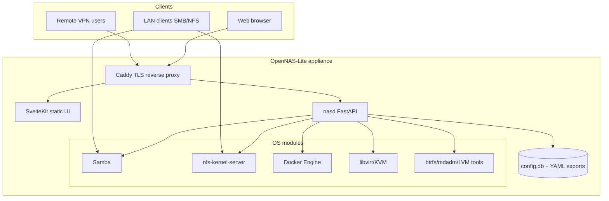

# Architecture overview

OpenNAS-Lite is a **single-appliance NAS**: a minimal Debian base, a privileged **management daemon** (`nasd`), a **web UI**, and **pluggable OS modules** (Samba, NFS, Docker, etc.) configured through one API and one configuration store.

## Design principles

1. **Safety first** — Destructive storage operations require confirmation tokens, dry-run previews, and audit logs. No silent `mkfs` or pool destroy.
2. **Graceful degradation** — Detect CPU/RAM/virtualization capabilities; hide or disable heavy modules with explicit user opt-in.
3. **Thin management layer** — Prefer battle-tested daemons (Samba, nftables, Docker) over reimplementing protocols.
4. **Reproducible builds** — ISO from pinned live-build config (Phase 2); configuration as versioned JSON/SQLite with export/import.
5. **Old hardware** — zram, systemd trimming, cgroup limits, and I/O priorities keep file serving responsive under load.

## Document map

| Doc | Contents |
|-----|----------|
| [block-diagram.md](block-diagram.md) | Logical and physical architecture, boot path |
| [modules.md](modules.md) | Feature modules A–H, dependencies, phases |
| [tech-stack.md](tech-stack.md) | Component choices and alternatives |
| [api-design.md](api-design.md) | REST resources, auth, errors, WebSockets |
| [security-model.md](security-model.md) | Trust boundaries, secrets, hardening |
| [data-model.md](data-model.md) | SQLite schema, config keys, job model |

## High-level context

## Boot and install path (summary)

1. **Live ISO** boots to lightweight environment + Calamares.
2. Installer writes root subvolume (Btrfs) or ext4 system partition, EFI partition, swap/zram config, and initial `config.db` seed.
3. First boot runs **setup wizard** (hostname, admin, network, storage profile).
4. `nasd` starts after `local-fs.target`; Caddy serves UI when setup is complete.

See [block-diagram.md](block-diagram.md) for install-time vs runtime separation.
