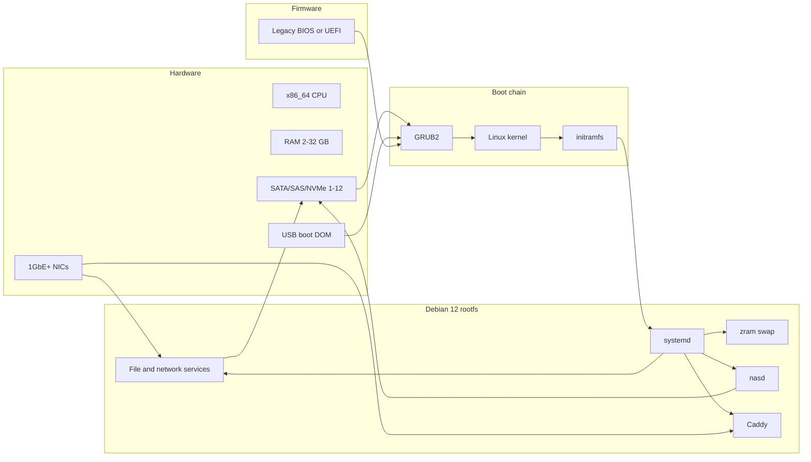
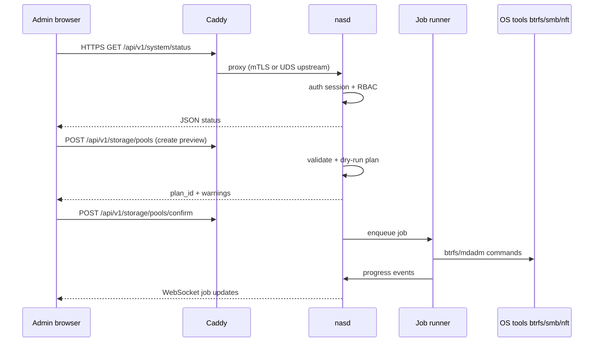
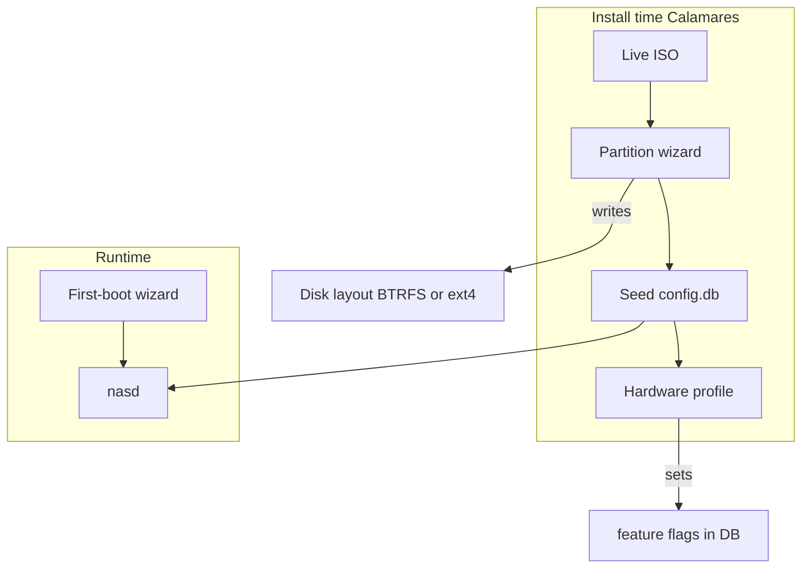

# Block diagram

## Physical deployment (typical appliance)

## Logical software layers

| Layer | Responsibility | Key components |
|-------|----------------|----------------|
| L0 Firmware | Boot device selection | UEFI/BIOS |
| L1 Bootloader | BIOS+UEFI, kernel cmdline | GRUB2, shim (UEFI) |
| L2 Kernel | Block, net, FS, cgroups | `linux-image-amd64`, optional `zfs`/`btrfs` |
| L3 Base OS | Packages, users, time, logging | Debian minimal, systemd, rsyslog/journald |
| L4 Storage stack | Pools, volumes, snapshots | btrfs tools, mdadm, LVM, optional OpenZFS |
| L5 Data services | Protocol endpoints | Samba, NFS, ProFTPD/vsftpd, sshd, WebDAV (Caddy/rclone serve) |
| L6 Platform | Containers/VMs | Docker, libvirt |
| L7 Management | API, UI, jobs, policy | `nasd`, Caddy, SvelteKit UI, `nasctl` |
| L8 Apps | User workloads | App Center Compose stacks |

## Management plane data flow

## Network exposure

| Surface | Default bind | Purpose |
|---------|--------------|---------|
| HTTPS 443 | All interfaces (or LAN only in Minimal) | Web UI + API |
| HTTP 80 | Redirect to HTTPS | ACME/http-01 if enabled |
| SMB 445 | LAN | File sharing |
| NFS 2049 | LAN optional | Unix clients |
| SSH 22 | Off by default; optional admin | Break-glass |
| WireGuard | UDP user-defined | Remote access |
| Docker published ports | Per-app | App Center only |

**Trust boundary**: Treat the management API as **administrator-equivalent**. LAN clients using SMB are a separate boundary (share ACLs).

## Install-time vs runtime

## Capability detection (runtime)

`nasd` publishes a **capability manifest** used by UI and installer recommendations:

| Capability | Detection | Effect if missing |
|------------|-----------|-------------------|
| `virt.kvm` | CPU flags + `/dev/kvm` | Hide VM manager |
| `ram.zfs` | RAM ≥ 8 GB + user opt-in | Disable ZFS pool creation |
| `cpu.avx` | CPU flags | Warn for ONNX AI module |
| `hw.transcode` | `/dev/dri/renderD*` | Jellyfin software transcode only |
| `docker` | cgroup v2, enough disk | App Center disabled in Minimal |

## Partition layout (default Btrfs install)

| Mount | Subvolume / device | Size guidance |
|-------|-------------------|---------------|
| `/boot/efi` | vfat ESP | 512 MB |
| `/` | `@` subvolume | ≤ 8 GB fixed or thin |
| `/var` | `@var` | grows with logs/docker |
| `/data` | separate subvolume or volume | remainder of system disk or data disks |

Data disks: dedicated btrfs raid or mdadm+LVM PV; **user data never on live ISO**.
