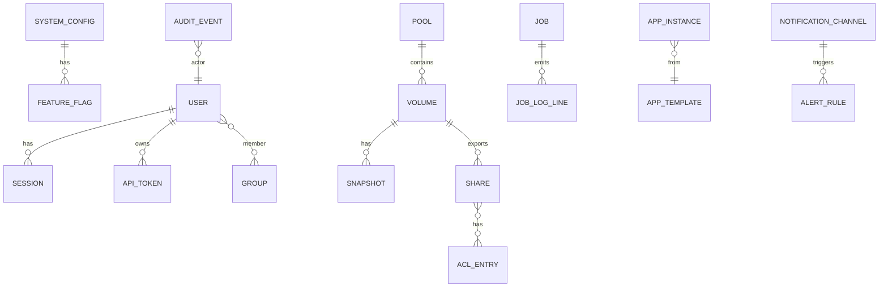

# Data model

Persistent state lives primarily in **SQLite** (`/var/lib/nasd/config.db`) with optional **YAML export** for git-friendly backups. Runtime state (job progress, metrics buffers) may use memory or `/run/nasd/`.

## Entity relationship

## SQLite pragmas

- `journal_mode=WAL`
- `foreign_keys=ON`
- `busy_timeout=5000`

## Tables (logical schema)

### `system_config`

Key-value settings for hostname, timezone, setup completion, hardware profile.

| Column | Type | Notes |
|--------|------|-------|
| key | TEXT PK | e.g. `network.hostname` |
| value_json | TEXT | JSON-encoded |
| updated_at | TEXT | ISO8601 |

### `feature_flags`

| Column | Type | Notes |
|--------|------|-------|
| name | TEXT PK | `docker`, `zfs`, `vms`, `ai_photos` |
| enabled | INTEGER | 0/1 |
| source | TEXT | `profile`, `user`, `capability` |

### `users`

| Column | Type | Notes |
|--------|------|-------|
| id | TEXT PK | UUID |
| username | TEXT UNIQUE | |
| display_name | TEXT | |
| role | TEXT | viewer, operator, admin, owner |
| password_hash | TEXT | nullable if system-only PAM user |
| totp_secret_enc | BLOB | nullable |
| webauthn_credentials_json | TEXT | nullable |
| created_at | TEXT | |

### `groups` / `user_groups`

Standard many-to-many for Unix group sync metadata.

### `sessions`

| Column | Type | Notes |
|--------|------|-------|
| id | TEXT PK | session id hash |
| user_id | TEXT FK | |
| expires_at | TEXT | |
| ip | TEXT | |
| user_agent | TEXT | |

### `api_tokens`

| Column | Type | Notes |
|--------|------|-------|
| id | TEXT PK | |
| user_id | TEXT FK | |
| name | TEXT | |
| token_hash | TEXT | |
| scope | TEXT | |
| last_used_at | TEXT | |

### `block_devices` (cache)

Discovered disks; refreshed on udev events.

| Column | Type | Notes |
|--------|------|-------|
| path | TEXT PK | `/dev/sda` |
| serial | TEXT | |
| model | TEXT | |
| size_bytes | INTEGER | |
| smart_status | TEXT | |
| pool_id | TEXT FK nullable | |

### `pools`

| Column | Type | Notes |
|--------|------|-------|
| id | TEXT PK | |
| name | TEXT UNIQUE | slug |
| backend | TEXT | `btrfs`, `mdadm`, `zfs` |
| raid_level | TEXT | `raid1`, `raid5`, ... |
| state | TEXT | `online`, `degraded`, ... |
| metadata_json | TEXT | device list, btrfs uuid |

### `volumes`

| Column | Type | Notes |
|--------|------|-------|
| id | TEXT PK | |
| pool_id | TEXT FK | |
| name | TEXT | |
| mount_path | TEXT | e.g. `/data/shares` |
| quota_bytes | INTEGER nullable | |
| compression | TEXT | btrfs option |

### `snapshots`

| Column | Type | Notes |
|--------|------|-------|
| id | TEXT PK | |
| volume_id | TEXT FK | |
| backend_id | TEXT | btrfs subvol name / zfs snap |
| created_at | TEXT | |
| retention_policy_id | TEXT nullable | |

### `shares`

| Column | Type | Notes |
|--------|------|-------|
| id | TEXT PK | |
| volume_id | TEXT FK | |
| name | TEXT | share name |
| protocols | TEXT | JSON array `["smb","nfs"]` |
| smb_options_json | TEXT | time machine, browseable |
| nfs_export_json | TEXT | |

### `acl_entries`

| Column | Type | Notes |
|--------|------|-------|
| id | TEXT PK | |
| share_id | TEXT FK | |
| principal | TEXT | user or group name |
| permission | TEXT | `rw`, `ro`, `none` |

### `jobs`

| Column | Type | Notes |
|--------|------|-------|
| id | TEXT PK | |
| type | TEXT | `pool.create`, `scrub`, ... |
| state | TEXT | `pending`, `running`, `success`, `failed` |
| progress | INTEGER | 0-100 |
| payload_json | TEXT | input params |
| result_json | TEXT | |
| created_at | TEXT | |
| finished_at | TEXT nullable | |

### `job_log_lines`

| Column | Type | Notes |
|--------|------|-------|
| id | INTEGER PK | |
| job_id | TEXT FK | |
| ts | TEXT | |
| line | TEXT | |

### `app_templates`

Catalog metadata mirrored from `apps/` manifests.

| Column | Type | Notes |
|--------|------|-------|
| id | TEXT PK | |
| name | TEXT | |
| compose_path | TEXT | |
| digest | TEXT | |
| min_profile | TEXT | minimal/standard/full |

### `app_instances`

| Column | Type | Notes |
|--------|------|-------|
| id | TEXT PK | |
| template_id | TEXT FK | |
| state | TEXT | |
| compose_project | TEXT | |
| resource_limits_json | TEXT | |

### `notification_channels` / `alert_rules`

Channel type (`email`, `telegram`, ...), encrypted credentials, rule expression JSON.

### `audit_events`

| Column | Type | Notes |
|--------|------|-------|
| id | TEXT PK | |
| ts | TEXT | |
| actor_user_id | TEXT | |
| action | TEXT | |
| target_type | TEXT | |
| target_id | TEXT | |
| outcome | TEXT | |
| meta_json | TEXT | |

### `confirm_tokens`

Short-lived tokens for destructive ops.

| Column | Type | Notes |
|--------|------|-------|
| token | TEXT PK | |
| operation | TEXT | |
| payload_hash | TEXT | |
| expires_at | TEXT | |

## Generated config files

`nasd` renders templates from DB to disk:

| Output | Source |
|--------|--------|
| `/etc/samba/smb.conf` | shares + users |
| `/etc/exports` | NFS |
| `/etc/nftables.conf` | firewall |
| `/etc/systemd/network/*.network` | network |
| `/var/lib/nasd/compose/<id>/docker-compose.yml` | app instances |

Renderer runs on change with validation (`testparm`, `exportfs -ra` dry checks).

## Config export bundle

Zip containing:

- `manifest.json` (version, timestamp, signature)
- `config.db` snapshot or `export/*.yaml` per domain
- **Excludes** `master.key` unless export encrypted with user passphrase

## Migration strategy

- `schema_version` in `system_config`
- Sequential migrations in `src/daemon/migrations/` (Phase 3)

## Indexing

- `jobs(state, created_at)`
- `audit_events(ts)`
- `shares(name)`

## Acceptance criteria

1. ER diagram matches implemented Alembic/SQL migrations in Phase 3.
2. Foreign keys enforce orphan prevention on delete (soft-delete pools first).
3. Export/import round-trip restores shares and firewall rules identically in test harness.
