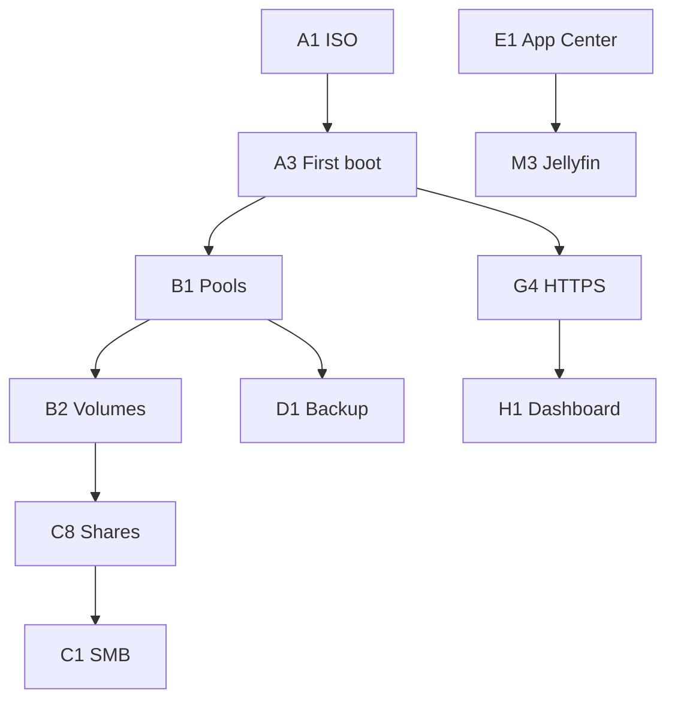

# Module list

Modules map to master-prompt checklist **A–H**. Each row lists **owner component**, **phase**, and **hard dependencies**.

Legend: **P2** build, **P3** core daemon, **P4** web UI, **P5** advanced, **P6** hardening.

## A. Installation and setup

| ID | Module | Description | Owner | Phase |
|----|--------|-------------|-------|-------|
| A1 | Live ISO + installer | debian-live ISO, Calamares, BIOS/UEFI | `build/` | P2 |
| A2 | Disk / RAID / pool wizard | Preview destructive ops, profile selection | Calamares + `nasd` install hooks | P2–P3 |
| A3 | First-boot setup wizard | Admin, hostname, network, timezone | `nasd` + web UI | P3–P4 |
| A4 | mDNS discovery | `opennas.local` / configurable | Avahi | P2 |
| A5 | Hardware compatibility check | Minimal / Standard / Full recommendation | `nasd` | P3 |

## B. Storage management

| ID | Module | Description | Owner | Phase |
|----|--------|-------------|-------|-------|
| B1 | Pool manager | Create/extend/import pools (btrfs/mdadm/ZFS opt-in) | `nasd` → storage workers | P3 |
| B2 | Volume manager | Subvolumes, datasets, mount options | `nasd` | P3 |
| B3 | RAID / JBOD | 0/1/5/6/10, btrfs raid profiles | OS tools + `nasd` | P3 |
| B4 | Mixed-size (“SHR-like”) | Btrfs raid1 with unequal devices + docs for limits | `nasd` + docs | P3–P5 |
| B5 | SMART | smartmontools, alerts | `nasd` + notifications | P3 |
| B6 | Scrub / balance schedules | cron/systemd timers | `nasd` | P5 |
| B7 | SSD cache | lvmcache or bcache where applicable | `nasd` | P5 |
| B8 | RAID migration | Online where supported; offline with warnings | `nasd` jobs | P5 |
| B9 | Disk power | hdparam/spindown, USB quirks | `nasd` | P5 |
| B10 | Snapshots | Scheduled + manual, retention policies | btrfs/ZFS tools | P5 |

## C. File services

| ID | Module | Description | Owner | Phase |
|----|--------|-------------|-------|-------|
| C1 | SMB | Samba, Time Machine vfs | `smbd` + `nasd` | P3 |
| C2 | NFS | nfs-kernel-server exports | `nfs` + `nasd` | P3 |
| C3 | FTP/SFTP | ProFTPD or vsftpd; OpenSSH sftp | system + `nasd` | P5 |
| C4 | WebDAV | Caddy WebDAV or dedicated module | Caddy/`nasd` | P5 |
| C5 | rsync | daemon optional, module config | `rsync` | P5 |
| C6 | iSCSI target | tgt or LIO optional | optional package | P5 |
| C7 | Web file manager | Upload, preview, shares, trash | web UI + `nasd` | P4–P5 |
| C8 | Shared folders + ACLs | POSIX ACLs, quotas | Samba + `nasd` | P3 |
| C9 | LDAP/AD join | sssd optional | optional | P5 |

## D. Backup and sync

| ID | Module | Description | Owner | Phase |
|----|--------|-------------|-------|-------|
| D1 | Local backup | restic to volume | `nasd` jobs | P5 |
| D2 | Cloud backup | rclone remotes | `nasd` | P5 |
| D3 | Schedules + verify | restic check, reports | `nasd` | P5 |
| D4 | Mobile backup endpoint | WebDAV/Nextcloud-compatible | C5 + App template | P5 |
| D5 | Syncthing | two-way sync | App Center | P5 |
| D6 | Time Machine | Samba time machine share | C1 | P3 |

## D2. Media and photos

| ID | Module | Description | Owner | Phase |
|----|--------|-------------|-------|-------|
| M1 | Photo index | EXIF, timeline, albums | `nasd` + SQLite FTS | P5 |
| M2 | Photo AI optional | ONNX face/OCR, CPU only | optional service | P5 |
| M3 | Jellyfin | App Center template | Docker | P5 |
| M4 | DLNA | optional miniDLNA | optional | P5 |

## E. Apps and virtualization

| ID | Module | Description | Owner | Phase |
|----|--------|-------------|-------|-------|
| E1 | App Center | Compose templates, limits | `nasd` + `apps/` | P5 |
| E2 | VM manager | libvirt domains, noVNC | `nasd` + virt | P5 |
| E3 | Docker UI | images, volumes, networks | `nasd` → docker API | P5 |

## F. Remote access and networking

| ID | Module | Description | Owner | Phase |
|----|--------|-------------|-------|-------|
| F1 | WireGuard | interface + peer UI | `wg` + `nasd` | P5 |
| F2 | Tailscale / Cloudflare | optional one-click templates | App/scripts | P5 |
| F3 | DDNS + ACME | Caddy on-demand TLS | Caddy + `nasd` | P5 |
| F4 | Network config | static, DHCP, VLAN, bond | systemd-networkd + `nasd` | P3 |
| F5 | Wi-Fi | optional NetworkManager or iwd | optional | P5 |
| F6 | UPnP/NAT hints | informational, miniupnp optional | optional | P5 |

## G. Security

| ID | Module | Description | Owner | Phase |
|----|--------|-------------|-------|-------|
| G1 | Firewall UI | nftables rulesets | `nasd` | P3–P4 |
| G2 | Intrusion block | fail2ban or nft sets | system + `nasd` | P5 |
| G3 | 2FA | TOTP, WebAuthn | `nasd` auth | P4 |
| G4 | HTTPS default | Caddy internal CA / LE | Caddy | P2–P3 |
| G5 | Encryption at rest | LUKS unlock, fscrypt dirs | `nasd` + cryptsetup | P5 |
| G6 | Audit log | admin actions, API mutations | `nasd` | P3 |
| G7 | ClamAV optional | scheduled scan | optional | P5 |
| G8 | Security advisor | config lint, updates | `nasd` | P6 |
| G9 | Unattended security upgrades | apt periodic | Debian | P2 |

## H. System and monitoring

| ID | Module | Description | Owner | Phase |
|----|--------|-------------|-------|-------|
| H1 | Dashboard metrics | CPU, RAM, disk, net, temps | `nasd` collectors | P4 |
| H2 | Notifications | email, Telegram, Discord, webhook | `nasd` | P5 |
| H3 | UPS | NUT | nut + `nasd` | P5 |
| H4 | Power schedules | systemd timers | `nasd` | P5 |
| H5 | WoL | wake-on-lan tool | `nasd` | P5 |
| H6 | OTA updates + rollback | btrfs snapshot pre-upgrade | `nasd` + apt | P6 |
| H7 | Config export/import | signed JSON bundle | `nasd` | P6 |
| H8 | nasctl CLI | all major operations | `src/cli` | P3 |
| H9 | OpenAPI | public API docs | `openapi/` | P1–P3 |
| H10 | Diagnostics bundle | tar of logs, sanitized config | `nasd` | P6 |

## Module dependency graph (core path)

## Acceptance criteria (architecture-level)

Each module in Phase 3+ must ship with:

1. **API routes** documented in OpenAPI with example payloads.
2. **Idempotent** create/update where possible; destructive ops require `confirm_token`.
3. **systemd** units or socket activation documented in `packaging/`.
4. **Tests**: unit tests for planners; integration tests marked `@destructive` for storage.
5. **Profile gating**: Minimal/Standard/Full flags respected in UI and API (`403` + `CAPABILITY_DENIED`).
