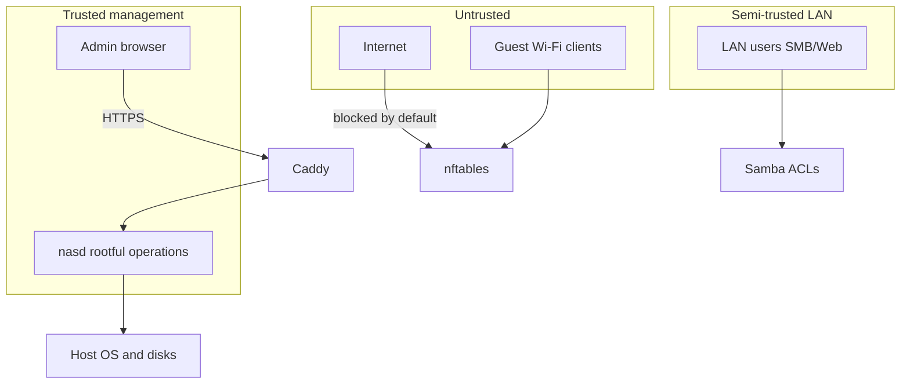

# Security model

## Assets

| Asset | Classification | Storage |
|-------|----------------|---------|
| User files on data volumes | Critical | Btrfs/ext4/ZFS data disks |
| `config.db` | High | `/var/lib/nasd/config.db` |
| Admin passwords | High | PAM shadow / argon2 hash in DB for UI-only users |
| API tokens | High | Hashed in DB; prefix shown |
| TLS private keys | High | `/var/lib/caddy` or `/etc/ssl/nasd` |
| WireGuard keys | High | `/etc/wireguard` + DB metadata |
| Audit logs | Medium | append-only table + journald |
| Metrics | Low | ephemeral |

## Threat actors

| Actor | Goal | Controls |
|-------|------|----------|
| Anonymous LAN client | SMB read/write | Share ACLs, no default open shares |
| Anonymous WAN | Scan/exploit UI | Firewall default deny WAN; HTTPS |
| Authenticated user | Escalate to admin | RBAC, 2FA step-up |
| Compromised container | Host escape | Docker defaults, no `--privileged` in templates |
| Malicious admin | Data wipe | Confirm tokens + optional delay |
| Physical attacker | Disk theft | LUKS/fscrypt optional |

## Trust boundaries

## Authentication controls

- **Password policy**: minimum 12 characters for admin; common password blocklist optional.
- **2FA**: TOTP (RFC 6238) and WebAuthn for admin accounts; enforced globally optional.
- **Session**: 24h sliding TTL; idle timeout 8h configurable; logout on password change.
- **Lockout**: 5 failed logins / 15 min per account + IP ban via nftables set.

## Transport

- TLS 1.2+ only on management HTTPS; modern cipher suites (Caddy defaults).
- Internal API on loopback/UDS; not exposed on `0.0.0.0` without explicit “expert mode” flag (discouraged).
- HSTS when using public hostname.

## Authorization

- **RBAC** on every route (see [api-design.md](api-design.md)).
- **Linux permissions**: `nasd` runs as `root` for storage/network mutations but drops to dedicated users for file manager read scopes where possible (`nasd-fm` + ACL-bound paths).
- **Samba**: `passdb backend = tdbsam` or ldap sync; map to Unix users.

## Secrets management

| Secret | Handling |
|--------|----------|
| API tokens | `argon2id` hash, prefix `onl_` |
| Session IDs | 256-bit random, stored hashed |
| Cloud backup passwords | AES-256-GCM in DB with key in `/var/lib/nasd/master.key` (600, root) generated at install |
| ACME accounts | Caddy storage |

**master.key** backup is included in encrypted config export; never in plaintext logs.

## Firewall default policy (installed system)

| Zone | Policy |
|------|--------|
| `lo` | accept |
| `lan` | accept established; new to 443, 445, 2049 per admin toggles |
| `wan` | drop incoming; allow established |
| `docker` | isolated bridge; publish ports explicit |

Admin UI edits generate nftables ruleset applied atomically with rollback file.

## Hardening baseline (image)

- SSH **disabled** by default; enable only with key-based auth recommended.
- `fail2ban` or nftables ban on ssh + login API.
- **Unattended-upgrades** for security suite.
- **AppArmor** enabled where Debian defaults provide profiles.
- **Kernel**: `slab_nomerge`, `init_on_free` where bookworm defaults allow without breaking old HW.

## Audit and logging

Log to `audit_events` table:

- actor (user id, IP, token id)
- action (`storage.pool.create`, etc.)
- target resource id
- outcome (`success`, `denied`, `failed`)
- hash of request body for mutations (no secrets)

Retention: 90 days default; export to syslog optional.

## Privacy

- No telemetry phoning home by default.
- Optional update check hits Debian security mirror only.
- Diagnostics bundle scrubs passwords, tokens, and Wi-Fi PSK.

## Security risks and mitigations

| Risk | Mitigation |
|------|------------|
| Ransomware on SMB | Snapshots, backups, write-only shares option |
| CSRF on web UI | SameSite cookies + CSRF token on mutating forms |
| SQL injection | SQLAlchemy parameterized queries only |
| Command injection | No shell=True; allowlisted subprocess argv |
| Supply chain (Docker images) | Curated catalog + digest pin in templates |

## Compliance notes

Not certified for HIPAA/PCI out of the box. Document encryption and access control for administrators pursuing compliance.

## Phase 3+ deliverables

- Pen-test checklist mapped to OWASP API Top 10
- `security-advisor` module scoring (G8)
- Automated tests for auth bypass and IDOR on shares API
